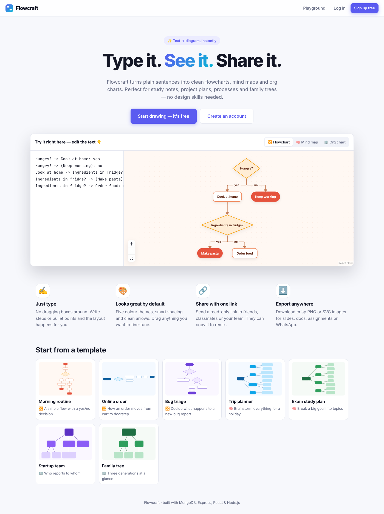
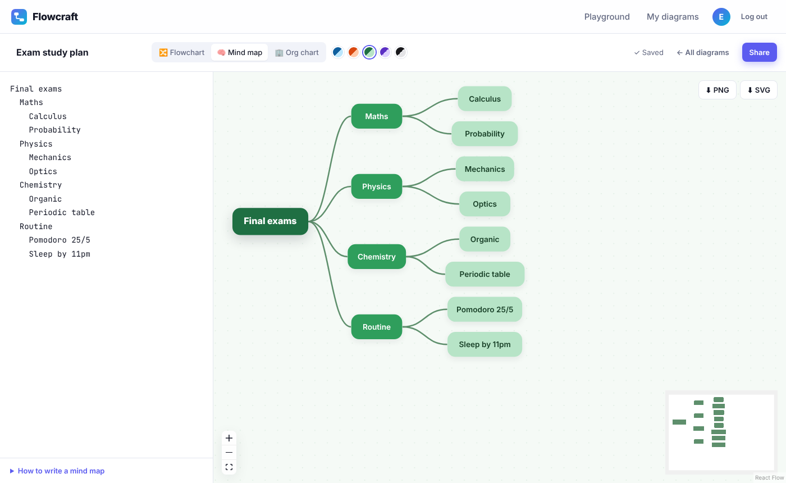
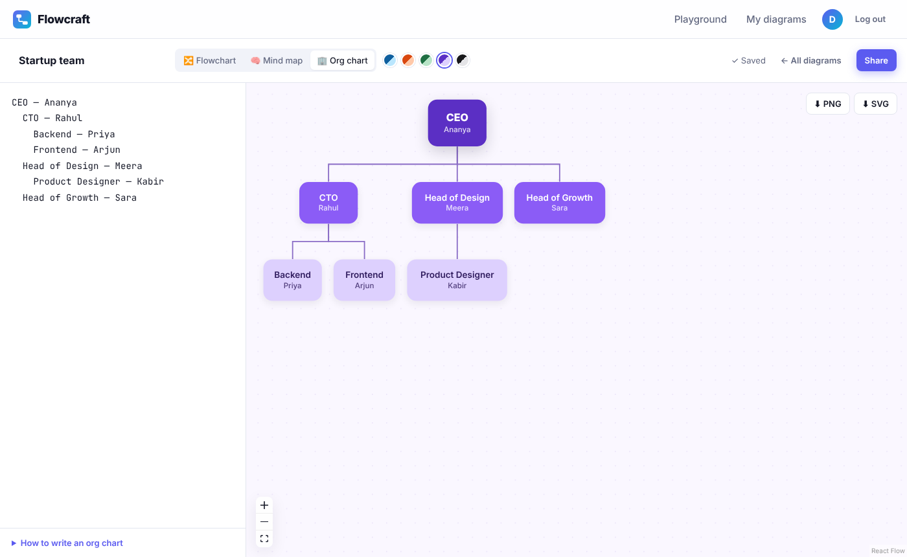
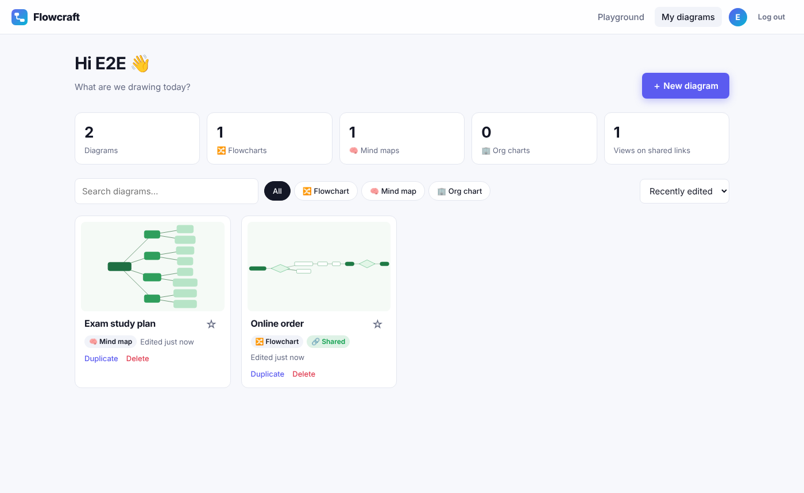
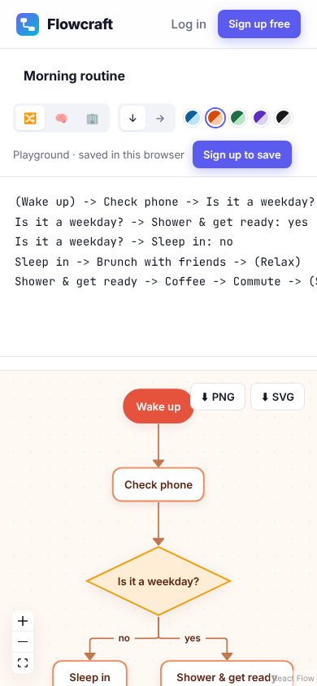

# Flowcraft — type it, see it, share it

**Flowcraft turns plain text into clean flowcharts, mind maps and org charts.**
Write a few lines like `Wake up -> Coffee -> Is it Monday?` or an indented list of ideas, and the diagram draws itself — with automatic layout, colour themes, drag-to-adjust, PNG/SVG export and shareable links.

It is built for everyday people, not just developers: students making study maps, small teams documenting a process, families sketching a family tree.



| Mind map | Org chart |
| --- | --- |
|  |  |

| Dashboard | Mobile |
| --- | --- |
|  |  |

---

## Features

**Diagram generation**
- ✍️ **Text → diagram in real time** — three diagram types:
  - **Flowchart:** `A -> B -> C`, decisions are any step ending in `?` (drawn as ◇), `(Start)` makes a rounded start/end step, `Ready? -> Go: yes` labels an arrow
  - **Mind map:** an indented outline (pasted Markdown bullet lists work too)
  - **Org chart / family tree:** indented list, `Name — Role` shows the role as a second line
- 📐 **Automatic layout** (top-down or left-right) using a graph-layout algorithm (dagre)
- 🖱️ **Drag nodes to fine-tune** — manual positions are saved; "Tidy up" resets them
- 🎨 **5 colour themes**, zoom/pan, minimap
- 💡 Friendly **parse hints with line numbers** (e.g. "Line 4: Arrow is missing a step on one side")
- ⌨️ Editor with **Tab / Shift+Tab indentation** for tree diagrams, and built-in syntax help

**Saving & sharing**
- 🔐 Sign up / log in (JWT)
- 💾 **Autosave** (debounced, only changed fields are sent) with save status and unsaved-changes warning
- 🗂️ **Dashboard** with live SVG previews, search, filters by type, sorting, ★ starring, duplicate & delete, and stats
- 🔗 **Public read-only share links** with view counter; viewers can **"Make a copy"** into their own account
- ⬇️ **Export as PNG or SVG** (the whole diagram, not just the visible area)
- 🧪 **Playground without an account** — work is kept in the browser and imported automatically after signing up
- 📚 **7 starter templates** (morning routine, online order, bug triage, trip planner, study plan, startup team, family tree)
- 📱 Responsive layout and dark-mode UI

---

## Tech stack

| Layer | Technology |
| --- | --- |
| Database | **MongoDB** with **Mongoose** (schemas, indexes, `Map` fields, aggregation pipeline for stats) |
| Backend | **Node.js** + **Express 5** REST API in **TypeScript**, **zod** validation, **JWT** + **bcrypt** auth, helmet, CORS, rate limiting |
| Frontend | **React 19** + **TypeScript** + **Vite**, React Router 7, **React Flow** (canvas), **dagre** (auto-layout), html-to-image (export) |
| Testing | **Vitest** + **Supertest** + **mongodb-memory-server** (API), Vitest unit tests (parser & layout) |
| Tooling | npm workspaces (monorepo), ESLint, Docker multi-stage build, docker-compose, GitHub Actions CI |

---

## Project structure

```
flowcraft/
├── server/                     # Express + MongoDB REST API (TypeScript)
│   ├── src/
│   │   ├── config/             # env + database connection
│   │   ├── models/             # Mongoose models: User, Diagram
│   │   ├── validators/         # zod schemas for every request
│   │   ├── middleware/         # auth (JWT), central error handler
│   │   ├── controllers/        # route handlers (auth, diagrams, shared)
│   │   ├── routes/             # Express routers
│   │   ├── lib/                # HttpError, validation helper, share-id generator
│   │   ├── app.ts              # Express app (also serves the React build in production)
│   │   ├── server.ts           # entry point
│   │   └── seed.ts             # demo data
│   └── tests/                  # API integration tests
├── client/                     # React app (TypeScript + Vite)
│   └── src/
│       ├── lib/diagram/        # ★ text parser, layout, themes, templates (+ unit tests)
│       ├── components/diagram/ # React Flow canvas, custom node shapes, thumbnails, export
│       ├── components/         # Workspace (editor UI), modals, navbar, shared UI
│       ├── pages/              # Landing, Auth, Dashboard, Editor, Playground, Shared
│       ├── api/                # typed fetch client
│       ├── context/            # auth + toast providers
│       └── hooks/              # useAsync, useDebouncedValue
├── Dockerfile                  # production image (API + built client in one container)
└── docker-compose.yml          # MongoDB (and optionally the full app)
```

**How a diagram is drawn:** the text is parsed into a graph of nodes and edges (`client/src/lib/diagram/parse*.ts`) → dagre computes positions (`layout.ts`) → any positions the user dragged are applied on top → React Flow renders custom node shapes. Node ids are derived from the text (e.g. `trip/stay/hotel`) so dragged positions stay attached to the right node while you keep typing.

---

## Getting started

### Prerequisites
- **Node.js 20+** (22 recommended)
- **MongoDB** — either a local install, Docker, or a free [MongoDB Atlas](https://www.mongodb.com/atlas) cluster

### 1. Clone and install
```bash
git clone https://github.com/devansh-jagtap/silver-octo-guacamole.git flowcraft
cd flowcraft
npm install          # installs both server and client (npm workspaces)
```

### 2. Start MongoDB
```bash
docker compose up -d mongo
```
(or use your own MongoDB / Atlas connection string)

### 3. Configure the API
```bash
cp server/.env.example server/.env
```
| Variable | Description | Default |
| --- | --- | --- |
| `PORT` | API port | `5000` |
| `MONGODB_URI` | MongoDB connection string | `mongodb://127.0.0.1:27017/flowcraft` |
| `JWT_SECRET` | Secret used to sign login tokens (**required in production**) | dev-only fallback |
| `JWT_EXPIRES_IN` | Token lifetime | `7d` |
| `CLIENT_ORIGIN` | Allowed browser origin(s), comma-separated | `http://localhost:5173` |

### 4. (Optional) add demo data
```bash
npm run seed
```
Creates the account **demo@flowcraft.app / demo12345** with three example diagrams (one of them publicly shared).

---

## Running the application

### Development
```bash
npm run dev
```
- React app: **http://localhost:5173**
- API: **http://localhost:5000/api** (Vite proxies `/api` to it, so no CORS setup is needed)

### Tests, type-checking and lint
```bash
npm test             # API integration tests + parser/layout unit tests
npm run typecheck
npm run lint
```
> The API tests start an in-memory MongoDB automatically (the binary is downloaded on the first run).

### Production
```bash
npm run build        # compiles the API and bundles the React app
NODE_ENV=production JWT_SECRET=your-secret MONGODB_URI=... npm start
```
In production Express serves the built React app, so the whole product is a single deployable service on port 5000.

### Docker
```bash
JWT_SECRET=your-secret docker compose --profile full up --build
```
Then open **http://localhost:5000**.

---

## REST API

All responses are JSON. Errors look like `{ "error": { "message": "...", "details": [{ "field": "email", "message": "..." }] } }`.

| Method | Endpoint | Auth | Description |
| --- | --- | --- | --- |
| `POST` | `/api/auth/register` | – | Create an account → `{ user, token }` |
| `POST` | `/api/auth/login` | – | Log in → `{ user, token }` |
| `GET` | `/api/auth/me` | ✔ | Current user |
| `GET` | `/api/diagrams?q=&type=&sort=` | ✔ | List my diagrams (search, filter, sort; starred first) |
| `GET` | `/api/diagrams/stats` | ✔ | Counts by type, shared count, total views (aggregation) |
| `POST` | `/api/diagrams` | ✔ | Create a diagram |
| `GET` | `/api/diagrams/:id` | ✔ | Get one of my diagrams |
| `PATCH` | `/api/diagrams/:id` | ✔ | Update title / text / type / theme / direction / positions / starred |
| `DELETE` | `/api/diagrams/:id` | ✔ | Delete |
| `POST` | `/api/diagrams/:id/duplicate` | ✔ | Duplicate |
| `POST` | `/api/diagrams/:id/share` | ✔ | `{ isPublic }` — turn the public link on/off (link id is kept) |
| `GET` | `/api/shared/:shareId` | – | Public read-only view (increments views) |
| `POST` | `/api/shared/:shareId/fork` | ✔ | Copy a public diagram into my account |
| `GET` | `/api/health` | – | Health check |

Security notes: passwords are hashed with bcrypt and never returned; other users' diagrams return **404** (not 403) so ids can't be probed; search input is regex-escaped; auth routes are rate-limited; request bodies are size-limited and validated with zod.

---

## Engineering notes — problems found and fixed

- **Infinite render loop on the canvas.** A default prop `positions = {}` created a new object every render, which re-ran the layout memo, reset React Flow's node store, and triggered "Maximum update depth exceeded". Fixed by using a module-level constant and keeping the parent's inline `onNodeMove` callback out of the memo's dependencies (via a ref).
- **"Ship it" and "Ship it?" merged into one node.** Node ids were slugs of the label, and the slug dropped the `?`. Caught by a layout unit test; question nodes now get their own id.
- **Stable node ids for tree diagrams.** Index-based ids made dragged positions jump to the wrong node when a line was inserted above. Ids are now path-based (`goa-trip/stay/hotel`), with a test proving they survive edits elsewhere.
- **Autosave race conditions.** The editor only sends changed fields, keeps a snapshot of what the server confirmed, and marks the state "unsaved" again if the user kept typing while a request was in flight.
- **PNG export errors.** html-to-image could not read the cross-origin Google Fonts stylesheet; adding `crossorigin="anonymous"` fixed both the errors and font embedding.
- **Two Vite versions in the monorepo** (one pulled in by vitest) broke type-checking of `vite.config.ts`; versions were aligned and the test config split out.

---

## AI tool used

> ✏️ **TODO (Devansh): fill this section in yourself before submitting.** Say truthfully whether you used **Code0** or **Kiro**, and describe your own experience. Don't keep any line here that isn't true.

**Tool:** _Code0 / Kiro_ ← keep the one you used

### AI development experience
_2–4 sentences on how you used the tool: what you asked it for, what it did well, where it got things wrong, and how you checked and corrected its output._

### Tasks where the AI tool helped
Write 3–5 specific tasks from your own sessions, for example:
1. _Component development: …_
2. _API creation: …_
3. _Debugging: …_ (e.g. one of the fixes listed under "Engineering notes")
4. _Database integration / testing / refactoring: …_

---

## License

MIT © Devansh Jagtap
