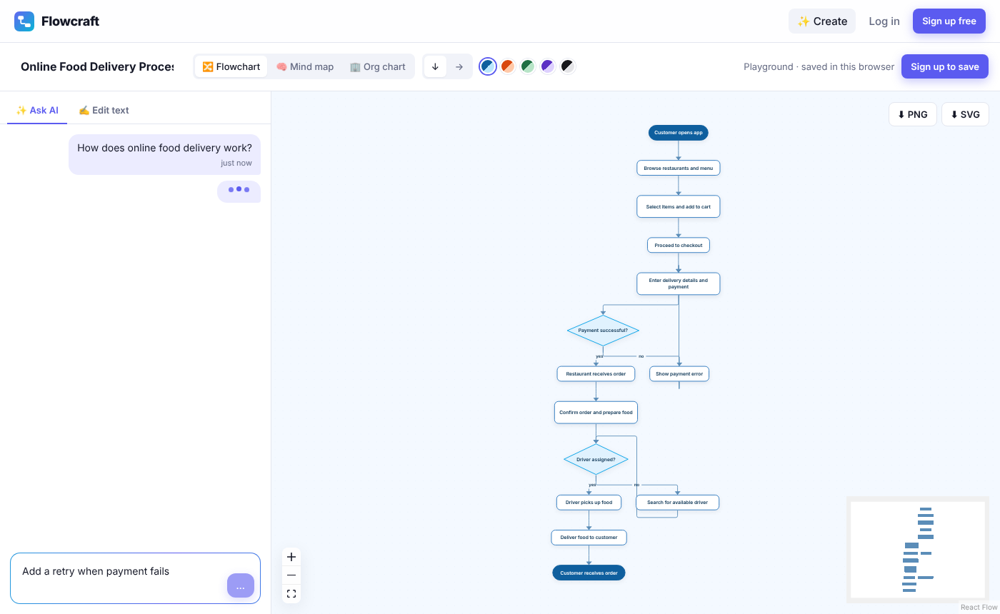

# Flowcraft

Describe something in plain words and get a diagram back.

Flowcraft turns a sentence like *"How does online food delivery work?"* into a clean flowchart, mind map, org chart, ER diagram or UML diagram (class, use case, sequence, state). You can then refine it by chatting (*"add a step for refunds"*), drag boxes around, change colours, share a read-only link or download a PNG or SVG.

It is made for everyday people: students mapping a subject, small teams writing down a process, families sketching a family tree. Prompts work in any language Gemini supports.


| AI chat and a generated flowchart | Generated mind map |
| --- | --- |
|  |  |

| Dashboard | Mobile |
| --- | --- |
|  |  |

<br />

## Quick start

You need **Node.js 22.9+** and **MongoDB** (local, Docker or a free [Atlas](https://www.mongodb.com/atlas) cluster).

```bash
git clone https://github.com/devansh-jagtap/silver-octo-guacamole.git flowcraft
cd flowcraft
npm install                          # installs server and client (npm workspaces)
docker compose up -d mongo           # or point MONGODB_URI at your own database
cp client/.env.example client/.env   # Clerk publishable key
cp server/.env.example server/.env   # Clerk secret key, MongoDB, Gemini
npm run dev
```

Open **http://localhost:5173**. The API runs on port 5000 and Vite proxies `/api` to it.

Optional: `npm run seed` adds three example diagrams for `demo@flowcraft.app`. Use `SEED_EMAIL=you@example.com npm run seed` to put them in your own account instead.

<br />

## Writing diagrams by hand

Every diagram is plain text. The AI writes the same text, so you can always open the **Text** tab and edit it yourself.

| Type | Write | Result |
| --- | --- | --- |
| Flowchart | `A -> B -> C` | steps joined by arrows |
| | `Ready?` | a step ending in `?` becomes a decision |
| | `Ready? -> Go: yes` | text after `: ` labels the arrow |
| | `(Start)` | a rounded start or end step |
| Mind map | an indented outline | the first line is the centre |
| Org chart | an indented list | indent means "reports to" |
| | `Priya: Backend` | the text after `: ` becomes a second line on the card |
| ER diagram (Chen) | `Student`, then indented `Roll no (key)` | an entity and its attributes; indent again for a composite attribute |
| | `(key)` `(partial key)` `(multivalued)` `(derived)` | underlined, dashed-underlined, double or dashed ovals |
| | `Dependent (weak)` | a weak entity (double border) |
| | `Student -- Enrolls -- Course: M:N` | a relationship diamond with cardinalities; `==` draws total participation |
| UML class | `class User`, then indented `- id: int`, `+ login(): bool` | a class with attributes and methods (also `interface`, `abstract class`, `enum`) |
| | `A --\|> B`, `A ..\|> B`, `A *-- B`, `A o-- B`, `A --> B`, `A ..> B` | inheritance, realisation, composition, aggregation, association, dependency |
| | `Customer "1" -- "*" Order: places` | multiplicities and a label |
| UML use case | `system Shop`, `actor Bank`, `Customer -> Pay` | system boundary, actors and use cases |
| | `Pay -> Log in: include` | `«include»` (or `extend`) |
| UML sequence | `actor User`, `database DB`, `User -> App: Log in` | lifelines and calls; `-->` reply, `-)` async |
| | `alt ok` … `else` … `end` | combined fragments (also `loop`, `opt`, `par`) |
| UML state | `[*] -> Idle`, `Idle -> Busy: start`, `Busy -> [*]` | initial and final states, transitions |

Lines starting with `#` are comments.

<br />

## Features

**AI**
- Prompt to diagram: Gemini picks the diagram type and writes it in Flowcraft's text syntax.
- Refine by chatting. Every AI change can be undone, and the prompt history is saved with the diagram.
- Answers are schema-checked and syntax-checked. If a step is disconnected or unreachable, the problem is sent back to the model for one automatic retry.
- The AI key stays on the server and generation is rate-limited per IP.

**Editing**
- Live preview while you type, with automatic layout (top-down or left-right) from dagre.
- Drag nodes to fine-tune; positions are saved, and **Reset layout** clears them.
- Five colour themes, zoom, pan and a minimap.
- Parse hints with line numbers, Tab and Shift+Tab indentation, built-in syntax help.

**Saving and sharing**
- Sign in with [Clerk](https://clerk.com).
- Autosave that only sends changed fields, with a save status and an unsaved-changes warning.
- A library with previews, search, sorting, starring, duplicate and delete.
- Public read-only links with a view counter. Viewers can make their own copy.
- Export the whole diagram as PNG or SVG.
- A playground that works without an account. The draft is imported after signing up.
- Twelve starter templates, including an ER diagram and UML class, use case, sequence and state diagrams.

<br />

## How it fits together

```
flowcraft/
├── client/                React + TypeScript + Vite
│   └── src/
│       ├── pages/         one file per route: Landing, Dashboard, Editor, Playground, Shared, Auth
│       ├── components/
│       │   ├── layout/    navbar, Clerk router bridge, protected routes
│       │   ├── landing/   the CSS MacBook that hosts the live demo
│       │   ├── library/   "My diagrams": sidebar, diagram cards, new-diagram dialog
│       │   ├── editor/    Workspace (toolbar + sidebar + canvas), text editor, themes, sharing
│       │   ├── ai/        prompt box and the chat-style AI panel
│       │   ├── diagram/   React Flow canvas, node shapes, static thumbnails, PNG/SVG export
│       │   └── ui.tsx     small shared pieces: spinner, empty/error states, dialogs, segmented control
│       ├── lib/diagram/   text parser, layout, themes, templates (with unit tests)
│       ├── api/           typed fetch client for the REST API
│       ├── context/       auth (Clerk) and toasts
│       ├── hooks/         useAsync, useDebouncedValue, useAiEnabled
│       └── styles/        tokens.css first, then one stylesheet per area of the app
├── server/                Express + MongoDB REST API (TypeScript)
│   ├── src/
│   │   ├── ai/            AI Gateway + Gemini clients, system prompt, output checks
│   │   ├── controllers/   route handlers
│   │   ├── routes/        Express routers
│   │   ├── models/        Mongoose models: User, Diagram
│   │   ├── validators/    zod schemas for every request
│   │   ├── middleware/    Clerk auth, error handler
│   │   └── lib/           HttpError, validation helper, share ids
│   └── tests/             API integration tests
├── Dockerfile             one production image: API plus the built client
└── docker-compose.yml     MongoDB, and optionally the full app
```

**How a diagram is drawn.** The text is parsed into nodes and edges (`client/src/lib/diagram/parse*.ts`). Dagre computes positions (`layout.ts`), any positions the user dragged are applied on top, and React Flow renders the custom shapes. Node ids come from the text (for example `trip/stay/hotel`), so a dragged node stays attached to the right box while you keep typing.

**Tech stack.** MongoDB with Mongoose, Express 5, zod, Clerk, Google Gemini (`gemini-2.5-flash`), React 19, React Router 7, React Flow, dagre, html-to-image, Vitest, Supertest and mongodb-memory-server, npm workspaces, ESLint, Docker and GitHub Actions.

<br />

## Configuration

`server/.env`:

| Variable | What it does | Default |
| --- | --- | --- |
| `CLERK_SECRET_KEY` | Verifies session tokens and reads profiles. **Required.** | |
| `CLERK_JWT_KEY` | Optional PEM public key to verify tokens without a network call | |
| `MONGODB_URI` | MongoDB connection string | `mongodb://127.0.0.1:27017/flowcraft` |
| `PORT` | API port | `5000` |
| `CLIENT_ORIGIN` | Allowed browser origins, comma-separated | `http://localhost:5173` |
| `AI_GATEWAY_API_KEY` | Enables AI generation through [Vercel AI Gateway](https://vercel.com/ai-gateway). Used instead of `GEMINI_API_KEY` when set. | |
| `AI_GATEWAY_MODEL` | Gateway model id | `google/gemini-2.5-flash` |
| `GEMINI_API_KEY` | Fallback when no gateway key is set: calls Gemini directly. Free at [aistudio.google.com/apikey](https://aistudio.google.com/apikey). Without it everything else still works. | |
| `GEMINI_MODEL` | Gemini model | `gemini-2.5-flash` |

`client/.env` only needs `VITE_CLERK_PUBLISHABLE_KEY`. Never commit `server/.env` and never put the secret or AI keys in client code.

Signing in creates a local user record on the first API request. Accounts from before Clerk are claimed by whoever signs in with the same verified email.

<br />

## Scripts

```bash
npm run dev         # API on :5000 and React app on :5173
npm test            # API integration tests and parser/layout unit tests
npm run typecheck
npm run lint
npm run build
```

The API tests start an in-memory MongoDB (the binary downloads on the first run).

**Production.** Build with `VITE_CLERK_PUBLISHABLE_KEY` set, then run `npm start` with `NODE_ENV=production`, `CLERK_SECRET_KEY`, `CLIENT_ORIGIN` and `MONGODB_URI`. Express serves the built React app, so everything runs as one service on port 5000.

**Docker.**

```bash
VITE_CLERK_PUBLISHABLE_KEY=pk_... CLERK_SECRET_KEY=sk_... docker compose --profile full up --build
```

Then open http://localhost:5000.

<br />

## REST API

Responses are JSON. Errors look like `{ "error": { "message": "...", "details": [{ "field": "title", "message": "..." }] } }`.

| Method | Endpoint | Auth | Description |
| --- | --- | --- | --- |
| `GET` | `/api/auth/me` | yes | Current user, created from the Clerk profile on first sign-in |
| `GET` | `/api/diagrams?q=&type=&starred=&sort=` | yes | List my diagrams |
| `GET` | `/api/diagrams/stats` | yes | Counts by type, shared count, total views |
| `POST` | `/api/diagrams` | yes | Create a diagram |
| `GET` | `/api/diagrams/:id` | yes | Get one of my diagrams |
| `PATCH` | `/api/diagrams/:id` | yes | Update title, text, type, theme, direction, positions, prompt history or starred |
| `DELETE` | `/api/diagrams/:id` | yes | Delete |
| `POST` | `/api/diagrams/:id/duplicate` | yes | Duplicate |
| `POST` | `/api/diagrams/:id/share` | yes | `{ isPublic }` turns the public link on or off; the link id is kept |
| `GET` | `/api/shared/:shareId` | | Public read-only view; increments views |
| `POST` | `/api/shared/:shareId/fork` | yes | Copy a public diagram into my account |
| `GET` | `/api/ai/status` | | `{ enabled }`: whether an AI Gateway or Gemini key is configured |
| `POST` | `/api/ai/generate` | | `{ prompt, current? }` returns `{ diagram: { title, type, direction, source } }`. Pass `current: { type, source }` to edit an existing diagram. Rate-limited per IP. |
| `GET` | `/api/health` | | Health check |

Authenticated requests send the Clerk session token as `Authorization: Bearer <token>`.

**Security.** Passwords never touch this app because Clerk owns them. Tokens are verified against Clerk's keys and the allowed origins. Other users' diagrams return 404 rather than 403, so ids can't be probed. Search input is regex-escaped, AI generation is rate-limited, and request bodies are size-limited and validated with zod.

<br />

## Engineering notes: problems found and fixed

**AI output** (found by testing against the real Gemini API, not just mocks)
- **Unconnected boxes.** Gemini sometimes listed steps on their own lines without arrows. The validator now rejects unconnected steps, and the system prompt asks for connections explicitly.
- **Whole diagram on one line.** Some answers contained the two characters `\n` instead of real line breaks. Output is now normalised before validation.
- **Typos that split a flow.** In a Hindi answer the model wrote the same step two slightly different ways, so the chain broke in two. The validator now checks that every step is reachable from the first one and names the unreachable steps, so the automatic retry can fix them.
- **Over-strict validation.** A lone `(Customer opens app)` line only sets the start shape and is connected on the next line. That is valid, so the rule became "connected somewhere" instead of "every line has an arrow".

**App**
- **Infinite render loop on the canvas.** A default prop `positions = {}` created a new object on every render, which re-ran the layout memo, reset React Flow's node store and triggered "Maximum update depth exceeded". Fixed with a module-level constant, and by keeping the parent's inline `onNodeMove` callback out of the memo's dependencies through a ref.
- **"Ship it" and "Ship it?" merged into one node.** Node ids were slugs of the label, and the slug dropped the `?`. A layout unit test caught it; question nodes now get their own id.
- **Stable node ids for tree diagrams.** Index-based ids made dragged positions jump to the wrong node when a line was inserted above. Ids are now path-based (`goa-trip/stay/hotel`), with a test proving they survive edits elsewhere.
- **Autosave race conditions.** The editor only sends changed fields, keeps a snapshot of what the server confirmed, and marks the state unsaved again if the user kept typing while a request was in flight.
- **Two Vite versions in the monorepo** (one pulled in by vitest) broke type-checking of `vite.config.ts`. The versions were aligned and the test config split out.

<br />

## AI tool used

> **TODO (Devansh): fill this section in yourself before submitting.** Say truthfully whether you used **Code0** or **Kiro**, and describe your own experience. Don't keep any line here that isn't true.

**Tool:** _Code0 / Kiro_ (keep the one you used)

### AI development experience
_2 to 4 sentences on how you used the tool: what you asked it for, what it did well, where it got things wrong, and how you checked and corrected its output._

### Tasks where the AI tool helped
Write 3 to 5 specific tasks from your own sessions, for example:
1. _Component development: ..._
2. _API creation: ..._
3. _Debugging: ..._ (for example one of the fixes listed under "Engineering notes")
4. _Database integration, testing or refactoring: ..._

<br />

## License

MIT © Devansh Jagtap
